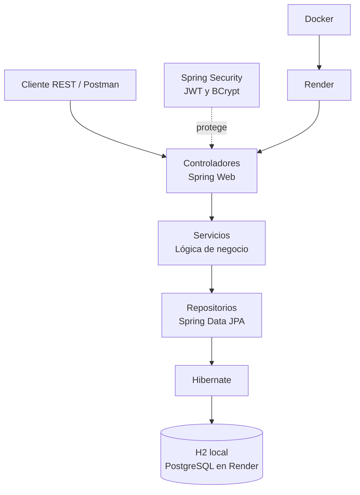

# Mini LIMS

Mini LIMS is a Spring Boot REST API for laboratory sample tracking. It provides JWT authentication with role-based access, sample status history, technician assignment, results, and administrator-managed users. The project runs locally with H2 and includes Docker and Render deployment configuration backed by PostgreSQL. Start it with Java 21 and `./mvnw spring-boot:run`; configure `JWT_SECRET` and the bootstrap administrator credentials first.

[](https://github.com/DanielOrtigosa/mini-lims-java/actions/workflows/ci.yml)

**Live demo:** [mini-lims.onrender.com](https://mini-lims.onrender.com/health) (the free service may take up to a minute to wake up).

Aplicación web de gestión de muestras de laboratorio desarrollada con Java y Spring Boot. El proyecto sigue un recorrido práctico desde la creación del modelo de datos y las operaciones CRUD hasta la trazabilidad de estados, la autenticación por roles, las pruebas y el despliegue con Docker.

Está inspirada en un flujo de trabajo LIMS y en la experiencia de prácticas en el área LIMS de Kymos. Es un proyecto personal de aprendizaje; no es un producto oficial de Kymos ni de LabWare.

## Qué permite hacer

- Gestionar muestras, resultados, estados y usuarios/técnicos mediante persistencia JPA.
- Crear, consultar, modificar y desactivar muestras y resultados.
- Asignar a una muestra un técnico activo.
- Avanzar una muestra por el flujo `PENDING → IN_ANALYSIS → COMPLETED` y consultar el historial de cambios.
- Iniciar sesión con email y contraseña para obtener un token JWT.
- Aplicar permisos por rol: `ADMIN` gestiona usuarios y estados; los roles `ADMIN`, `TECHNICIAN` y `TECNICO` pueden usar las operaciones de trabajo.
- Probar la API con la colección de Postman incluida.

## Tecnologías

- Java 21 y Maven
- Spring Boot 4, Spring Web, Spring Security y Spring Data JPA
- Hibernate
- H2 en memoria para desarrollo local y PostgreSQL para el despliegue configurado
- JWT con HS256 y contraseñas cifradas con BCrypt
- Docker y Render

## Capas de la aplicación



## Requisitos

- JDK 21
- Git

## Ejecutar en local

Clona el repositorio y arranca la aplicación:

```bash
git clone https://github.com/DanielOrtigosa/mini-lims-java
cd mini-lims-java
./mvnw spring-boot:run
```

En Windows PowerShell:

```powershell
.\mvnw.cmd spring-boot:run
```

La aplicación queda disponible en `http://localhost:8080`. En local usa una base H2 en memoria, que se reinicia al detener la aplicación.

### Crear el primer administrador

Al arrancar, la aplicación crea un usuario administrador si no existe otro con el email indicado. Define las credenciales mediante variables de entorno:

```powershell
$env:BOOTSTRAP_ADMIN_EMAIL = "admin@example.com"
$env:BOOTSTRAP_ADMIN_PASSWORD = "<contraseña-segura>"
$env:JWT_SECRET = "<clave-base64-de-al-menos-32-bytes>"
.\mvnw.cmd spring-boot:run
```

Para usar una clave JWT propia, configura también `JWT_SECRET` con una cadena Base64 que represente al menos 32 bytes:

```powershell
$env:JWT_SECRET = "<clave-base64-de-al-menos-32-bytes>"
```

Configura `JWT_SECRET` con una cadena Base64 que represente al menos 32 bytes (puedes generarla con `openssl rand -base64 32`). La aplicación no arranca sin ella. No guardes credenciales ni claves reales en el repositorio. La clave aislada de `src/test/resources/application.properties` solo se usa al ejecutar pruebas.

## API

La API REST principal incluye estos recursos:

| Recurso | Rutas principales | Acceso |
|---|---|---|
| Autenticación | `POST /api/auth/login` | Público |
| Muestras | `/api/samples` y `/api/samples/{id}` | JWT y rol operativo |
| Resultados | `/api/results` y `/api/results/{id}` | JWT y rol operativo |
| Estados | `/api/statuses` y `/api/statuses/{id}` | JWT; escritura solo para `ADMIN` |
| Salud | `GET /health` | Público |

Las muestras también disponen de estas operaciones:

```text
PATCH /api/samples/{sampleId}/technician/{technicianId}
POST  /api/samples/{id}/status/advance
GET   /api/samples/{id}/status/history
```

El endpoint de avance aplica el flujo de estados y guarda cada transición en el historial.

### Inicio de sesión

Envía las credenciales de un usuario activo:

```http
POST /api/auth/login
Content-Type: application/json
```

```json
{
  "email": "admin@example.com",
  "password": "tu-contraseña"
}
```

La respuesta incluye `accessToken`. En las peticiones protegidas, envíalo en la cabecera:

```http
Authorization: Bearer <accessToken>
```

## Probar la API con Postman

Importa [`postman/LIMS-Samples.postman_collection.json`](postman/LIMS-Samples.postman_collection.json), configura las variables `adminEmail` y `adminPassword`, ejecuta **Login as configured administrator** y después **Create sample**. La colección guarda el token y el identificador de la muestra para las peticiones siguientes.

## Pruebas automatizadas

Ejecuta las pruebas con Maven:

```bash
./mvnw test
```

En Windows PowerShell:

```powershell
.\mvnw.cmd test
```

Hay pruebas para los servicios de muestras, resultados, estados y usuarios, pruebas REST de creación, consulta, modificación y borrado, y pruebas de seguridad y del administrador inicial. Al desactivar un usuario/técnico se conserva su registro y sus asignaciones para mantener la trazabilidad; el usuario deja de poder iniciar sesión y no puede recibir nuevas asignaciones.

## Despliegue

Antes de desplegar una versión con este esquema, respalda y vacía la base de datos de demostración: las columnas `version` y `changedBy` son nuevas, y los valores duplicados de `sampleCode` o `email` impiden crear las restricciones de unicidad.


El repositorio incluye un `Dockerfile` y [`render.yaml`](render.yaml) para desplegar en Render con PostgreSQL. Conecta el repositorio en Render y crea un Blueprint a partir de ese archivo. Configura un email y una contraseña nuevos para el administrador inicial.

Render genera `JWT_SECRET` y proporciona al servicio las credenciales de la base de datos. Tras el despliegue, comprueba `https://<tu-servicio>.onrender.com/health` y utiliza `POST /api/auth/login` para obtener un token.

El Blueprint usa planes gratuitos para facilitar una demo. El servicio puede tardar en reanudarse tras un periodo inactivo y la base de datos gratuita tiene una duración limitada; consulta las condiciones actuales de Render antes de usarlo para conservar datos.

## Recorrido del proyecto

El desarrollo se organizó en etapas: configuración de Spring Boot y conexión a la base de datos; entidades, repositorios y servicios; API REST y pruebas manuales; flujo de estados y trazabilidad; autenticación JWT y permisos por rol; validaciones y pruebas automatizadas; y empaquetado y despliegue. La guía también propone revisiones iterativas y un pulido general del repositorio como parte del proceso.

El proyecto continúa evolucionando y sirve como práctica de Java, SQL y Spring Boot.


## Gestión de usuarios y páginas

Los usuarios se administran en `/api/users`, solo con rol `ADMIN`. `GET /api/users?page=0&size=20` lista usuarios; `POST /api/users` crea un usuario con `name`, `email`, `role`, `password` y, opcionalmente, `department` y `location`; `PUT /api/users/{id}` actualiza el perfil; `PATCH /api/users/{id}/activation` con `{"active": false}` desactiva la cuenta y con `{"active": true}` la reactiva. Desactivar conserva el registro y las asignaciones. Los JWT emitidos antes de la desactivación siguen válidos hasta caducar (una hora).

Los listados de muestras, resultados y estados también aceptan `page` y `size`, por ejemplo `GET /api/samples?page=0&size=5`. Las respuestas de muestras, resultados y usuarios usan DTOs y no incluyen contraseñas ni entidades relacionadas completas.
